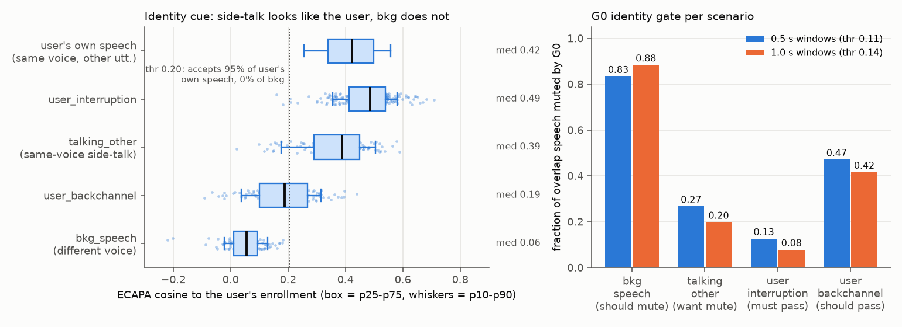

# Pilot R: same-voice side-talk vs. identity gating (FDB v1.5), local pilot

*ECE 6256 final-project topic decision. Run 2026-11-02, 18:17–19:01 local time (~45 min wall-clock, of which roughly 25 min was installs and downloads). Everything ran on the laptop (CPU for the ECAPA work, RTX 3070 8 GB for the TTS). The Moshi runs are prepared but not executed because PACE-ICE is refusing logins. These are pilot numbers on 498 benchmark clips with one speaker-embedding model; treat them as indicative.*



## TL;DR

* **The central claim holds on FDB v1.5.** The talking_other overlap is the user's own voice. An identity gate set to accept 95% of the user's own speech accepts **88% of talking_other clips** and **0% of bkg_speech clips** (clip-level ECAPA). The window-level G0 gate mutes **83–88% of bkg_speech audio** but only **20–27% of talking_other audio**.
* **Caveat 1: one voice.** talking_other, bkg_speech and user_backchannel all use a **single shared user voice** (call it voice X: male, F0 ≈ 120 Hz). Only user_interruption has many voices. Any training or evaluation built on FDB therefore sees one user voice, and comparisons between interruption and the other subsets are confounded by voice pool.
* **Caveat 2: easy shortcuts.** The side-talk cell is **lexically near-trivial**: 99/100 talking_other utterances open with a vocative ("Dad, …", "Coach Garcia, …"). The same trivial rule fires on 3% of interruptions. The side-talk is also acoustically marked (far-field rendering). A model trained on FDB-style data can score well through the vocative or the far-field cue without "addressee understanding". The proposal needs a harder, de-shortcut test set, which our own TTS data could provide. Chatterbox voice cloning works on the 3070 at ~5–7 s per utterance.

---

## 1. Environment and exact commands

| item | value |
|---|---|
| analysis env | `C:/Users/W_YI/miniconda3/envs/fdb` (Python 3.11.18; torch 2.6.0+cpu, torchaudio 2.6.0+cpu, speechbrain 1.0.3, huggingface_hub 0.36.2 (**must be <1.0** for speechbrain 1.0.3), numpy 2.4.6, pandas 3.1.0, scipy 1.17.1, soundfile 0.14.0, matplotlib 3.11.2, requests). Size on C: is 1.9 GB |
| TTS env | `F:/AI/conda_envs/fdb_tts` (Python 3.11; torch 2.6.0+cu124, chatterbox-tts 0.1.7, **setuptools<81**, needed because perth imports `pkg_resources`). 5.6 GB, placed on F: (outside OneDrive) because C: had only ~10 GB free (now **5.7 GB free, 99% full**) |
| speaker model | `speechbrain/spkrec-ecapa-voxceleb`, copied to `runs/models/` (`LocalStrategy.COPY`; Windows symlinks fail) |
| benchmark repo | `fdb/` = DanielLin94144/Full-Duplex-Bench @ `3e799c4` (2026-05-20), shallow clone |

```bash
PY=C:/Users/W_YI/miniconda3/envs/fdb/python.exe          # all scripts run with -I, from pilot_R/
"C:/Users/W_YI/miniconda3/Scripts/conda.exe" create -n fdb python=3.11 -y
$PY -m pip install --no-cache-dir torch==2.6.0 torchaudio==2.6.0 --index-url https://download.pytorch.org/whl/cpu
$PY -m pip install --no-cache-dir speechbrain==1.0.3 soundfile numpy scipy matplotlib pandas requests "huggingface_hub<1.0"
git clone --depth 1 https://github.com/DanielLin94144/Full-Duplex-Bench.git fdb
# v1.5 data (Google Drive folder 1ReqGkU-oGC1CCm_U9boPqH5jRt0PNJAs, 4 zips, 228 MB total) -> data/zips, unzip -> data/v1_5
curl -L "https://drive.usercontent.google.com/download?id=<ID>&export=download&confirm=t" -o <name>.zip
#   background_speech 1W63k1BlQ0QCgvYCb_8YJNqFfUhBwI97W (24.6 MB) | talking_to_other 1Jh6ER4AUmqGgEZBTV0pcbDaMMQIWA7Kt (28.7 MB)
#   user_backchannel 1EGwCd9CdGuh8jeqwPENzbBs5FSEgnYL3 (23.2 MB) | user_interruption 1wqYcYS4-30W2YMc3TfeMeoiaW9PLf4yT (151 MB)
$PY -I scripts/inventory.py          # step 1 data map           -> runs/inventory/        (~20 s)
$PY -I scripts/spk_similarity.py     # step 2 ECAPA sims+thresh. -> runs/similarity/       (~8 min CPU)
$PY -I scripts/voice_check.py        # step 2b F0 + voice pools  -> runs/similarity/voice_check.json (~6 min)
$PY -I scripts/voice_matched.py      # step 2c voice-matched thr -> runs/similarity/voice_matched.json (~3.5 min)
$PY -I scripts/lexical_check.py      # step 2d vocative shortcut -> runs/similarity/lexical_check.json
$PY -I scripts/g0_gate.py --win 0.5 --ctx 0 --thr auto --write_wavs 1   # step 3 G0 -> runs/g0/win0.5_ctx0.0/ (~6 min)
$PY -I scripts/g0_gate.py --win 1.0 --ctx 0 --thr auto --write_wavs 0   # sensitivity  -> runs/g0/win1.0_ctx0.0/ (~5 min)
$PY -I scripts/make_figure.py        # -> runs/pilot_R_main.png
F:/AI/conda_envs/fdb_tts/python.exe -I scripts/tts_demo.py              # step 5 -> runs/tts_demo/
```

## 2. Data map (step 1)

* **Location.** The audio is **not in the repo**. `fdb/v1_v1.5/dataset/README.md` links a Google Drive folder that holds four zips (sizes above), so I downloaded only the v1.5 overlap sets.
* **License.** The repo code is CC BY-NC 4.0 (`fdb/LICENSE`). The dataset README says *v1.0 synthetic and v1.5 data: MIT*, and the Candor/ICC-derived v1.0 data is CC BY-NC 4.0.
* **Per-clip folder.** Each clip folder holds:
  * `input.wav` (with the overlap)
  * `clean_input.wav` (overlap removed)
  * `context.wav` (the user's first query)
  * the raw overlap file: `current_turn.wav`, `background.wav`, `backchannel.wav` or `interrupt.wav`
  * `input.json` and `clean_input.json`: Parakeet word-level ASR, **already provided**
  * `metadata.json`
* **Exact timestamps.** `metadata.json` = `{context_text, <overlap>_text, timestamps:[t0,t1]}`, where `timestamps` gives the exact overlap window. No voice IDs are provided.

| subset (folder) | clips | sr / ch | clip len | overlap onset t0 | overlap len | overlap level in mix* | HF tilt vs user** |
|---|---|---|---|---|---|---|---|
| talking_other (`talking_to_other`) | 100 | 16 kHz mono | 11.5–14.6 s | 4.8–7.3 s | 1.4–2.7 s (mean 2.1) | direct path −6.4 dB (LS gain), total −2.0 dB incl. reflections | −2.9 dB |
| bkg_speech (`background_speech`) | 100 | 16 kHz mono | 11.1–14.1 s | 4.9–7.1 s | 1.0–2.8 s (mean 1.7) | −17.3 dB direct / −14.9 dB total | −7.5 dB |
| user_backchannel | **98** (README and paper say 99) | 16 kHz mono | 11.3–13.5 s | 5.6–7.5 s | 0.56–1.16 s | 0 dB | (n/a, short) |
| user_interruption | 200 | 16 kHz mono | 12.1–17.9 s | 5.2–8.8 s | 1.7–5.6 s (mean 3.3) | 0 dB | −1.7 dB |

\*Relative to the un-mixed overlap file, from `scripts/inventory.py` and an LS-gain check.
\*\*Energy above 4 kHz in the overlap minus the same quantity for the user's context speech.

**Construction (measured).**
* Every clip is: user query (`context.wav`, ~2 s) → **exactly 4.0 s of silence** (where the model is supposed to be answering) → overlap at `t0`.
* The levels and filters match the paper's description: talking-to-others gets −8 dB, a −5 dB high-shelf above 4 kHz, and reflections at 45/120 ms; background gets −15 dB, a 3 kHz low-pass and an echo.
* The user's "own speech before the overlap" (enrollment) is therefore a single ~1.7 s query. This is short by speaker-verification standards.

**Overlap transcripts (examples).**
* talking_other: "Dad, microwave just quit on us." / "Coach Garcia, ankle's still kinda sore." / "Paul, poke me if I forget to send that email."
* bkg_speech: "Do we have any milk left?" / "Could you turn the TV down a bit?"
* user_backchannel: "uh-huh", "mm-hmm yeah", "right yeah"
* user_interruption: "Actually, what are some financial goals I should set?" / "Hold on, what time is the meeting scheduled today?"

Per-clip CSV: `runs/inventory/clips.csv`.

**Desired behaviour (paper, arXiv 2507.23159).**
* interruption → **Respond**
* backchannel → **Resume**. Note that the task brief grouped backchannel with yield/respond, but the paper wants the model to keep the floor.
* talking-to-others → **Resume** (a brief Uncertain is acceptable)
* background → **Resume**

**How v1.5 labels Respond/Resume.**
1. `fdb/v1_v1.5/get_transcript/asr.py` runs **nvidia/parakeet-tdt-0.6b-v2** (NeMo, GPU) to produce word-timestamped `output.json` and `clean_output.json`.
2. `evaluation/evaluate.py --task behavior` → `eval_behavior.py` sends `{input_clean, input_noisy, output_clean, output_noisy}` word lists to the judge **OpenAI `gpt-4o-2024-08-06`**, using the prompt `evaluation/instruction/behavior.txt`.
3. The judge returns exactly one of `C_RESPOND / C_RESUME / C_UNCERTAIN_HANDLING / C_UNKNOWN` for the first new semantic segment after the overlap onset. C_UNKNOWN covers "no speech after the overlap" and off-target content.
4. Latencies come from `get_timing.py` (silero VAD).

## 3. Identity cue (step 2): ECAPA cosine(enrollment, overlap)

**Method.**
* Enrollment = `input.wav[0:t0]` with silent 20 ms frames dropped (≈ the user's query).
* Overlap = `input.wav[t0:t1]` (metadata timestamps, so nothing was estimated).
* I also compare against the **raw** overlap file, to separate voice identity from the far-field rendering.

| scenario | n | mean | median | p10 | p90 | median vs raw (un-mixed) file |
|---|---|---|---|---|---|---|
| user_interruption (same voice, many voices) | 200 | 0.474 | 0.486 | 0.356 | 0.580 | 0.458 |
| **talking_other** (same voice X, far-field) | 100 | 0.364 | **0.389** | 0.174 | 0.504 | 0.435 |
| user_backchannel (same voice X, 0.3–0.8 s) | 98 | 0.182 | 0.188 | 0.035 | 0.315 | 0.192 |
| **bkg_speech** (different voice) | 100 | 0.050 | **0.056** | −0.021 | 0.130 | 0.074 |
| ref: voice X vs voice X, different utterances, clean (19,900 pairs) | – | – | 0.423 | 0.256 | 0.558 | – |

**Voice pools (`voice_check.json`).**
* Enrollments are near-identical across clips in three subsets: cross-clip cosine 0.42–0.46, F0 ≈ 120 Hz with 88–97% below 165 Hz.
* Within talking_other, the side-talk is exactly as close to *another clip's* enrollment as to its own: 0.366 vs 0.364, own-enrollment rank 50/100.
* Enrollments versus user_interruption enrollments score only 0.025.
* **Conclusion:** talking_other, bkg_speech and user_backchannel are all voiced by **one** TTS user voice. user_interruption uses a varied pool: cross-clip 0.16, F0 bimodal (53% male-like), own-enrollment top-5 = 28%.
* The bkg talker is a clearly different, higher voice (F0 ≈ 180 Hz vs 124 Hz for the user).
* The paper's text never literally says "same voice" for talking-to-others (it says "simulate the user speaking away from the device"). The data confirms it is the user's voice.

**Threshold analysis.**

| threshold rule | thr | interruption accepted | bkg accepted | **talking_other accepted as user** | backchannel accepted |
|---|---|---|---|---|---|
| EER, interruption vs bkg (as specified) | 0.181 | 0.995 | 0.01 | **0.89** | 0.52 |
| ↳ held-out: tuned on even ids, scored on odd ids | 0.182 | 0.99 | 0.00 | **0.92** | 0.49 |
| 95% of interruptions accepted | 0.328 | 0.95 | 0.00 | 0.65 | 0.08 |
| **voice-matched**: 95% of voice-X-vs-voice-X accepted | 0.204 | (voice X: 0.95) | 0.00 | **0.88** | – |
| voice-matched EER (voice X vs bkg) | 0.170 | (voice X: 0.968) | 0.03 | 0.90 | – |

* AUC, interruption vs bkg = **0.9998**. AUC, voice X vs bkg = 0.994. So the identity gate separates the different-voice cell almost perfectly at clip level.
* AUC, interruption vs talking_other = 0.765, which looks partly separable. Most of that comes from the **voice-pool confound**: the voice-matched AUC (user's clean speech vs talking_other) is only **0.61**, and raw vs processed side-talk is 0.62.
* The far-field rendering lowers similarity only slightly (median 0.435 → 0.389).
* The low tail of talking_other is driven by short segments: r = 0.51 with overlap duration and 0.46 with enrollment duration. For example, clip 35 has a 0.74 s enrollment and cosine 0.02.
* **The prediction holds:** talking_other ≈ same-voice, bkg_speech far lower. It does not fail because of the −8 dB/high-shelf processing.

## 4. G0 identity gate (step 3, `scripts/g0_gate.py`)

**Method.**
* The user channel is cut into non-overlapping windows.
* Each window with ≥ 20% active frames gets an ECAPA cosine to the clip's enrollment. Windows below threshold are zeroed.
* The threshold is the window-level EER between bkg_speech overlap windows and user_interruption overlap windows, **tuned on even clip ids**.
* "Muted" = the fraction of speech-active 20 ms frames inside `[t0,t1]` that the gate zeroed.
* Gated wavs (same sr and length as the input; usable as the G0 condition for Moshi) are in `runs/g0/win0.5_ctx0.0/wavs/<scenario>/<id>.wav`, 498 files, 208 MB.

| scenario (desired gate action) | 0.5 s windows (thr 0.106): overlap audio muted | clips ≥50% muted | held-out odd ids | 1.0 s windows (thr 0.136): muted | clips ≥50% muted |
|---|---|---|---|---|---|
| bkg_speech (mute) | **0.83** | 0.92 | 0.85 | **0.88** | 0.93 |
| talking_other (we want mute) | **0.27** | 0.17 | 0.26 | **0.20** | 0.12 |
| user_interruption (must pass) | 0.13 (wrongly muted) | 0.025 | 0.11 | 0.08 | 0.02 |
| user_backchannel (pass) | 0.47 (wrongly muted) | 0.40 | 0.53 | 0.42 | 0.45 |
| pre-overlap user speech (pass) | 0.007–0.027 | – | – | 0.002–0.016 | – |

* The fixed-threshold sweep is in `runs/g0/*/summary.json`. **No threshold mutes most of talking_other without also muting most interruptions.** For example, at thr 0.3 the gate mutes 90% of talking_other but also 74% of interruption audio.
* Window-level similarity is much noisier than clip-level. The 0.5 s window medians are: bkg 0.04, talking_other 0.17, interruption 0.22, backchannel 0.10.

## 5. Three example clips

| clip | user query → overlap (t0–t1) | clip cosine (vs raw) | G0 0.5 s muted | reading |
|---|---|---|---|---|
| `talking_to_other/13` | "What's the latest stock price for Apple?" → **"Bro, pass me the hot sauce, please."** (6.18–8.27 s) | 0.396 (0.462) | 0.07 | typical side-talk: as "user-like" as the user's own speech, so the gate passes it and Moshi would hear it as the user |
| `background_speech/53` | "Open my reading list." → **"I can't log into my account."** (5.44–7.07 s) | 0.056 (0.104) | 0.82 | different voice: the gate rejects it cleanly |
| `user_interruption/49` | "I'm considering changing my career path" → **"Oh, before I forget, let's switch to talking about holiday plans."** (5.82–9.74 s) | 0.487 (0.454) | 0.20 | genuine interruption: passes, though G0 still clips 20% of its audio |

Extra:
* `talking_to_other/41` ("Sam, your parcel's at the front desk.") has cosine 0.588, the highest of any side-talk clip and above most interruptions.
* `talking_to_other/35` (0.74 s query "Mute the TV.") has cosine 0.02. The cause is the short enrollment, not a different voice.

## 6. Moshi offline job for PACE (step 4, prepared, NOT run)

* **`scripts/run_moshi_offline.py`.**
  * Loads **kyutai/moshiko-pytorch-bf16** once, through the kyutai `moshi` pip package. It is not gated.
  * Per wav, it replays exactly the frame loop of kyutai `moshi/server.py::recv_loop`: 24 kHz, 1920-sample frames, drops the first encoded frame, then `LMGen.step` → `mimi.decode`.
  * It reproduces FDB's client alignment (1 leading frame of zeros, then trim or pad to the input length).
  * It writes `output.wav` / `clean_output.wav` and copies the provided `input.json` / `clean_input.json`.
  * `--input_override runs/g0/.../wavs` produces the **Moshi + G0** condition.
* **Why not the alternatives.**
  * The repo's `fdb/v1_v1.5/model_inference/moshi/inference.py` is the FDB inference example for Moshi. It is a websocket client that streams in **real time** to `python -m moshi.server`. It also has a bug: `root_dir_path` is a `str` joined with `/`.
  * kyutai `python -m moshi.run_inference in.wav out.wav` reloads the 7B model per file and skips the server's first-frame convention.
  * PersonaPlex's `python -m moshi.offline --input-wav --output-wav` lives in **NVIDIA's fork** of `moshi`, which has a different LMGen API (voice/text prompts), and defaults to the **gated** `nvidia/personaplex-7b-v1`. I did not touch it and accepted no gated terms.
* **`slurm/run_moshi_fdb.sbatch`.** Requests 1× H100 (L40S alternative), 64 GB RAM, 4 h. It runs:
  1. raw, clean and G0 inference
  2. Parakeet ASR: `python asr.py --root_dir OUT/<cond>/<task> --task default --audio_name output.wav`, then the same with `clean_output.wav`
  3. scoring, from `fdb/v1_v1.5/evaluation/`: `python evaluate.py --task behavior --root_dir OUT/<cond>/<task>` and `python get_timing.py --root_dir OUT/<cond>/<task>`
* **Untested.** Neither script has executed. The first PACE run should use `--limit 3`.

## 7. Local voice-cloning TTS (step 5)

* **Setup.** Chatterbox 0.1.7 installed cleanly on Windows in ~14 min, which includes the 2.5 GB CUDA torch download. One fix was needed: `pip install "setuptools<81"`, because `perth` imports `pkg_resources`.
* **Reference.** 12 s of voice X, built from `talking_to_other/1–5/context.wav`.
* **Outputs.** `runs/tts_demo/side_talk_{1,2,3}.wav`:

| text | gen time | audio length | RTF |
|---|---|---|---|
| "Hey Tom, can you grab the door?" | 4.6 s | 1.6 s | 2.8 |
| "Sorry Maria, give me one second, I'm on a call." | 6.9 s | 3.0 s | 2.3 |
| "Tom, did you remember to feed the dog this morning?" | 6.3 s | 2.6 s | 2.5 |

* **Speed and memory.** Model load 13.7 s, peak VRAM 3.9 GB. Throughput is ~600 utterances per hour, so a few-thousand-utterance training set is an overnight job on the 3070. The GPU was shared with another process at the time.
* **Voice match.** ECAPA cosine of the clones to voice-X enrollments is 0.37–0.41 (median), within the same-voice reference range (0.42). Against the bkg voice it is 0.01–0.11. So cloned side-talk is "the user" as far as an identity gate can tell.
* **Not checked.** Intelligibility (no ASR pass) and listening quality.
* Chatterbox embeds an imperceptible Perth watermark.

## 8. Signals for the decision

1. **Is the same-voice construction confirmed? Yes.**
   * The talking_other overlap is voiced by the user's own TTS voice. Raw-file cosine 0.435 ≈ the same-voice reference 0.42, the register is the same (F0 120 → 131 Hz), and the bkg voice scores 0.06.
   * The far-field rendering barely moves identity: cosine −0.05, AUC 0.62.
   * Nuance: the paper text implies but does not state "same voice". Also, **all three non-interruption subsets share one single user voice**.
2. **Does an identity gate separate bkg_speech from interruption cleanly? At clip level, yes; at 0.5–1 s window level, mostly.**
   * Clip level: AUC 0.9998. At the EER threshold it accepts 99.5% of interruptions and 1% of bkg.
   * Window-level G0: mutes 83–88% of bkg audio and wrongly mutes 8–13% of interruption audio.
   * G0 also mutes 42–47% of backchannel audio, because short tokens give unreliable embeddings. This is mostly harmless for Resume, but it shows the gate is coarse.
3. **What fraction of talking_other can an identity gate not handle? ≈ 65–92% of clips, 73–80% of side-talk audio.**
   * 88–92% of clips are accepted as the user at thresholds that keep ≥95% of genuine user speech.
   * Even the stricter threshold that keeps exactly 95% of interruptions still accepts 65%.
   * G0 lets 73–80% of side-talk audio through.
   * Remaining risk: the small separability that does exist (AUC 0.61 voice-matched) is the far-field rendering, not addressee.
4. **Blocked by PACE.**
   * All Moshi numbers are blocked: raw, clean and Moshi+G0 Respond/Resume rates, so whether G0 actually helps on bkg_speech is still open.
   * Needs a GPU with ≥ 24 GB. The 3070 cannot hold the 7B bf16 model.
   * Scoring also needs an **OpenAI API key**, and the `gpt-4o-2024-08-06` snapshot must still be available, otherwise our numbers will not be comparable to the published ones.
   * Parakeet ASR (0.6B) could run locally on the 3070 once outputs exist.
5. **Risks observed.**
   * **Lexical shortcut.** 99/100 talking_other utterances start with a vocative naming a non-system addressee. A trivial "comma within the first 3 words, not a discourse marker" rule flags 99% of talking_other and 3% of interruptions (and 3% of bkg). On FDB this cell is solvable without addressee *understanding*, so a fine-tuned model could learn "vocative → ignore" and fail on vocative-free side-talk or on "Hey Moshi, …". **We need our own harder test split.**
   * **Acoustic shortcut.** Every side-talk item carries the same far-field signature (direct path −6 dB, −3 dB HF tilt, reflections), while every interruption is near-field. Controls needed: near-field side-talk and far-field genuine interruptions.
   * **One user voice** in 3 of 4 subsets. There is a risk of overfitting to that voice, and a voice-pool confound when comparing to interruptions. Any trained gate or model must be tested on unseen voices.
   * **Short enrollment** (~1.7 s): absolute ECAPA cosines are low (same-voice median ≈ 0.42–0.49), and the gate results depend on window length.
   * **Metric.** Moshi's published talking_other labels are dominated by Unknown (.59). A "keep talking" improvement may show up as Unknown→Resume or be masked by the judge, so plan to report latency and VAD-based measures alongside the judge labels.
   * **Infrastructure.**
     * C: is at 99% (5.7 GB free).
     * Two dependency pins were required: `huggingface_hub<1.0` for speechbrain and `setuptools<81` for chatterbox.
     * The user_backchannel set has 98 clips, not 99.
     * `user_interruption/` ships stray `errors.log` and `.DS_Store` files.

## 9. File index

* `scripts/`
  * `common.py`, `inventory.py`
  * `spk_similarity.py`, `voice_check.py`, `voice_matched.py`, `lexical_check.py`
  * `g0_gate.py`, `make_figure.py`, `tts_demo.py`, `run_moshi_offline.py`
* `slurm/run_moshi_fdb.sbatch`
* `runs/`
  * `inventory/` (`clips.csv`, `summary.json`)
  * `similarity/` (`sims.csv`, `summary.json`, `threshold.json`, `voice_check.json`, `voice_matched.json`, `lexical_check.json`, `hist.png`, `emb_cache.npz`)
  * `g0/win0.5_ctx0.0/` (`summary.json`, `clips.csv`, `windows.csv`, `g0_mute_rates.png`, `wavs/`)
  * `g0/win1.0_ctx0.0/`
  * `tts_demo/`
  * `pilot_R_main.png`
  * logs
* `data/zips/` (228 MB) and `data/v1_5/` (extracted, 555 MB). These are in OneDrive; the zips can be deleted.
